<p align="center">
  <a href="https://marcelosaldanha-1978.github.io/painel-gof-baaplog/"></a>
</p>

<p align="center">
  <a href="https://github.com/marcelosaldanha-1978/painel-gof-baaplog/actions/workflows/montagem.yml"></a>
  <a href="https://github.com/marcelosaldanha-1978/painel-gof-baaplog/actions/workflows/ci.yml"></a>
  <a href="https://github.com/marcelosaldanha-1978/painel-gof-baaplog/actions/workflows/vigia.yml"></a>
  
  
</p>

<h3 align="center">
  <a href="https://marcelosaldanha-1978.github.io/painel-gof-baaplog/">▶ Abrir o painel</a> ·
  <a href="https://marcelosaldanha-1978.github.io/painel-gof-baaplog/dados.json">dados.json</a> ·
  <a href="https://github.com/marcelosaldanha-1978/painel-gof-baaplog/tree/main/dados/painel">histórico das montagens</a>
</h3>

> **Projeto encerrado em 23/11/2026, em operação mínima até a 1ª carga do Tesouro Gerencial de 2027.** O painel acompanha o encerramento do exercício financeiro de 2026 das seis OMDS da BaApLog, na ordem da Portaria SEF/C Ex nº 399/2026, e se atualiza sozinho: sem computador ligado e sem pessoa na rotina.

---

## O que o painel responde

<table>
<tr>
<td width="25%" align="center"><h3>⏳</h3><b>Quanto falta?</b><br><sub>Dias úteis até cada marco do Calendário da Portaria 399</sub></td>
<td width="25%" align="center"><h3>💰</h3><b>O que está em tela?</b><br><sub>Crédito disponível por UG e o que já venceu o prazo da NC</sub></td>
<td width="25%" align="center"><h3>🧾</h3><b>O que falta liquidar?</b><br><sub>Empenhado × liquidado e o empenhado há mais de 60 dias ainda não liquidado</sub></td>
<td width="25%" align="center"><h3>📦</h3><b>E os restos a pagar?</b><br><sub>RPNP a liquidar e bloqueado, por UG; índice da BaApLog contra o da 1ª RM</sub></td>
</tr>
</table>

<details>
<summary><b>📖 Siglas usadas aqui</b></summary>

| Sigla | Significado |
|---|---|
| **OMDS** | Organização Militar Diretamente Subordinada (as seis da BaApLog) |
| **UG 160xxx / 167xxx** | as duas Unidades Gestoras de cada OMDS no SIAFI |
| **UGE / UGR / UGP** | UG executora, UG responsável (que descentraliza o crédito) e UG participante |
| **NC / NE / OB** | nota de crédito, nota de empenho, ordem bancária |
| **ND** | natureza de despesa |
| **RPNP** | restos a pagar não processados (empenhado e não liquidado que passa para 2027) |
| **TG / DW / SIAFI** | Tesouro Gerencial, o *data warehouse* com os dados do SIAFI (sistema de execução do governo federal) |
| **SERPRO** | empresa que opera o TG e envia as assinaturas por e-mail |
| **B1, B3, B4** | blocos do motor: B1 execução (empenho e liquidação), B3 carteira de processos, B4 itens a verificar |
| **P-041** | pendência do projeto que criou a ponte do TG |
| **D13, D14, D17** | decisões do projeto (publicidade, segredos, Portal como reserva) |
| **PNCP / ARP / UASG / SALC** | Portal Nacional de Contratações Públicas, ata de registro de preços, unidade de compras, seção de licitações |
| **PCA / BI / EME / D Cont / ev.** | Plano de Contratações Anual, boletim interno, Estado-Maior do Exército, Diretoria de Contabilidade, evento do Calendário |

</details>

<p align="center">
  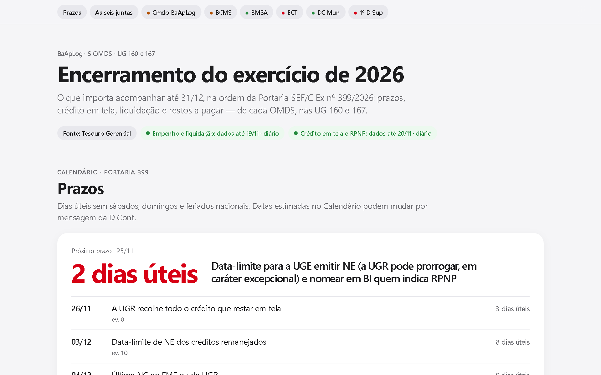
  &nbsp;
  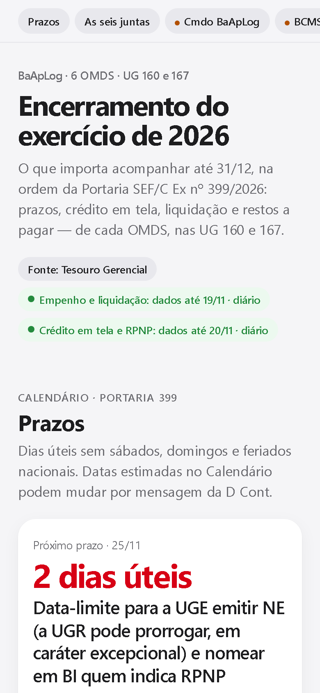
</p>

---

## As seis OMDS, uma a uma — UG 160 e UG 167

<p align="center">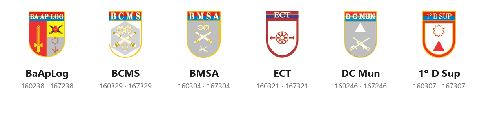</p>

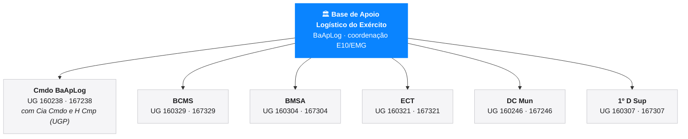

Cada OMDS aparece com o seu brasão e as **duas UG** lado a lado. Em cada UG, o número principal é o **crédito em tela** (vermelho se há vencido de R$ 1.000 ou mais); abaixo, empenhado e % do recebido, liquidado (barra), a liquidar (com o que está há +60 dias) e restos a pagar.

<p align="center">
  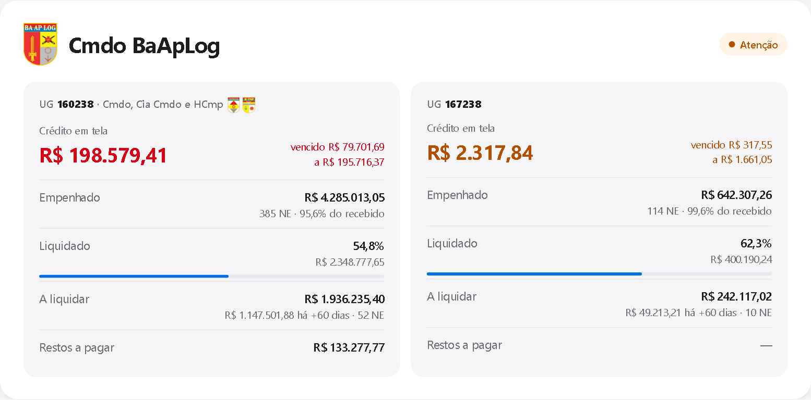
  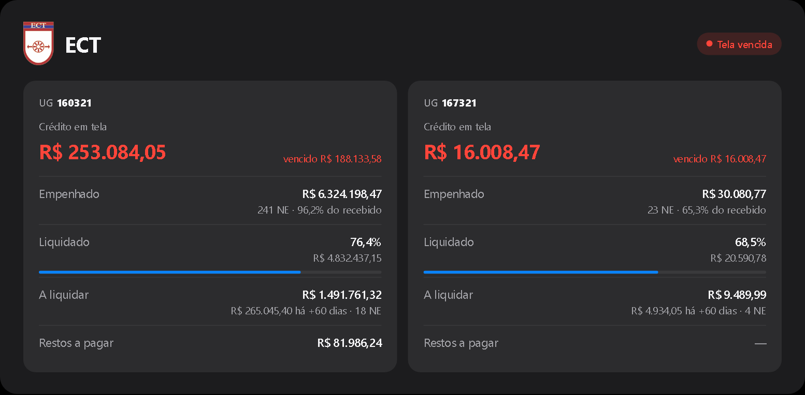
</p>

---

## Do Tesouro Gerencial à tela, sem pessoa

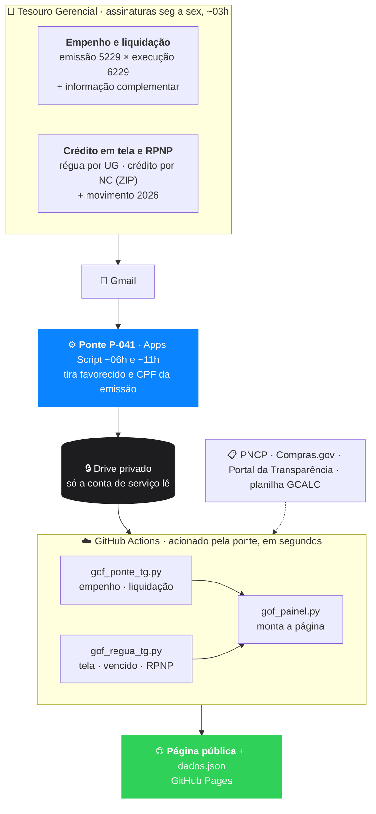

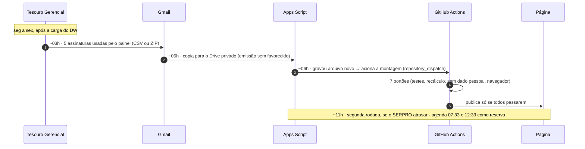

> **Se o SERPRO não disparar** uma assinatura, nada quebra: o painel mantém o último dado bom e mostra a data dele na faixa de status. **Se o PNCP não responder** durante a montagem, a página do dia não é publicada e fica a anterior.
>
> **Horário:** desde 23/11/2026 a ponte **aciona a montagem por evento** assim que grava arquivo novo (~06h e ~11h); a montagem começa em segundos e a página fica pronta por volta das 06h15–06h30. A agenda do GitHub Actions (07:33 e 12:33) fica como reserva — ela atrasa horas: de 19 a 23/11 saiu entre ~14h45 e ~19h.

---

## Sete portões antes de publicar

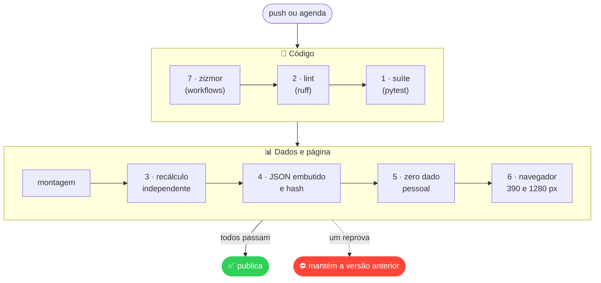

Travas de conteúdo além dos portões: o crédito em tela por NC só entra se a soma das células **fechar com o crédito disponível da régua em cada UG** (tolerância de R$ 1,00 ou 0,1%, o que for maior); o B1 só entra se o líquido conferir **ao centavo** com o **item 23** (empenhado) do TG.

---

## Calendário que baliza a página — Portaria SEF/C Ex nº 399/2026

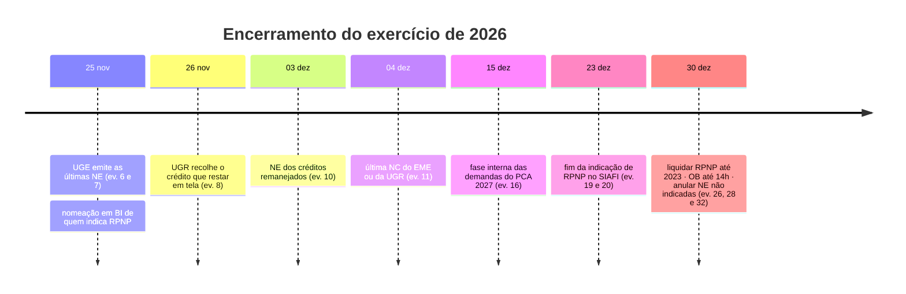

Datas marcadas como «estimadas» no Calendário podem mudar por mensagem da D Cont; ficam em `MARCOS_ENCERRAMENTO` (`motor/gof_painel.py`).

---

## Automação

| | Workflow | Quando (Brasília) | O que faz |
|---|---|---|---|
| 🟢 | `montagem.yml` | acionada pela ponte (~06h e ~11h, por evento); agenda 07:33 e 12:33 como reserva | ponte do TG, régua, portões e publicação |
| 🔵 | `ci.yml` | a cada push | portões de código |
| 🟣 | `fichas-pncp.yml` | segunda 07:17 | pregões, atas e fornecedores (PNCP e Compras.gov) |
| 🟠 | `conferencia.yml` | segunda 08:03 | confronto planilha × portais (só leitura) |
| 🟡 | `vigia.yml` | segunda e quinta 08:41 | avisa montagem parada, dado parado e o lembrete anual do TG |
| ⚪ | `capacidade.yml` | segunda 02:17 | capacidade imediata de empenho em atas (no `dados.json`, fora da página) |

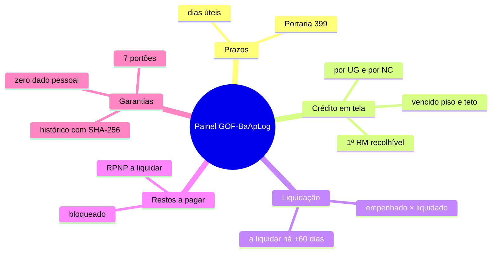

---

<details>
<summary><b>📂 Fontes e dados (<code>dados/</code>)</b></summary>

- `liquidacao/ultimo.json` — empenhado, liquidado, a liquidar e +60 dias por UG e OMDS (mesma ponte do B1).
- `execucao/` — **extrato sem pessoa** da execução, **alimentado pela ponte do TG (P-041, instalada em 23/11/2026; o extrato vigente, de 19/11, foi gerado à mão a partir das assinaturas)**: as assinaturas do TG chegam por e-mail; o Apps Script `v2PonteTG` do GOF (06h e 11h) grava na pasta privada `PONTE_TG_SEM_PESSOA` do Drive (a emissão já sem as colunas de favorecido); a montagem lê o par mais recente (`motor/gof_ponte_tg.py`), confere líquido = item 23 e gera o extrato. Execução (TG, empenhado líquido nas contas 6229201xx, com a emissão 522920101 de apoio; UG 160xxx e 167xxx): NE, UG, data, valor, modalidade e o nível do vínculo com os pregões. O CSV do Tesouro Gerencial, que tem favorecido, nunca entra neste repositório.
- `pncp/` — fichas dos 12 processos da carteira (PNCP e Compras.gov), semanais.
- `carteira_processos.json`, `kpis_painel.json` — carteira e KPI do Painel da planilha GCALC, relidos a cada montagem pela conta de serviço só de leitura (`gof_planilha.py`).
- `portal/` — extrato sem pessoa do Portal da Transparência (janela de 10 dias úteis por dia; carga desde 01/01), reserva do B1.
- `conferencia/` — confronto semanal planilha × portais (`ultimo.json` entra no B4); a gravação do que o portal prova era feita fora daqui, pela tarefa semanal do Claude, desativada no encerramento (23/11/2026); hoje o confronto só lê.
- `pendencias_coordenador.json` — pendências do coordenador, com a data da última edição visível no painel.
- `capacidade/` — capacidade imediata de empenho das 6 UASG por fontes oficiais (Compras.gov.br, módulo ARP, e Contratos.gov.br), sem listas das SALC. O saldo de ata é calculado aqui: registrado × preço − empenhado no TG (`insumo_tg.json`, sem pessoa). Desde a v0.2 separa o item registrado **por valor** (preço unitário até R$ 1,00) do registrado por quantidade, lista os 5 maiores itens por OMDS e classifica o empenhado fora da coleta em 5 classes. **Não aparece na página; vai no `dados.json`.**
- `encerramento/` — **`regua.json`: crédito em tela, vencido (piso e teto) e RPNP por UG e por OMDS, gerado na nuvem desde 23/11/2026** (3 assinaturas do TG: «REGUA CREDITO E RPNP POR UG» (relatório «Execução Crédito e RPNP por UG v1.0»), «CREDITO EM TELA POR NC» — ZIP, o CSV cruzado tem 62 MB — e «CREDITO POR NC MOVIMENTO 2026»; o `v2PonteTG` copia para a pasta privada e `motor/gof_regua_tg.py` calcula). Trava: a soma das células por NC tem de fechar com o crédito disponível da régua em cada UG (tolerância de R$ 1,00 ou 0,1%); se não fechar, mantém a régua anterior. Vencido = NC recebida de outra UG com prazo escrito anterior à data de referência («empenho imediato» conta como vencido); o piso não rastreia ajuste de ND da própria UG até a NC de origem (mais conservador que a auditoria manual). `ultimo.json` (+60/+90 dias, RPNP por ano, irrisórios) continua manual, a cada exportação; `referencia_1rm` (planilha da 1ª RM de 10/11) é fixa.
- `dispensa/` — leitura **sem pessoa** do empenhado em dispensa por valor (Lei nº 14.133/2021, art. 75, I e II), por UG e subitem da natureza de despesa, contra o teto do ano (`ultimo.json`; origem e limites em `dispensa/LEIAME.md`). Atualização manual a cada exportação do TG.
- `painel/<data>/` — cada montagem (dados.json, index.html, atas do PNCP, SHA256SUMS); `painel/ultimo/` é a vigente.

</details>

<details>
<summary><b>📐 Regras que o código cumpre</b></summary>

- **Vínculo NE → pregão (regra v2.0, chave SIASG da NE):** SIASG (a chave aponta para pregão da carteira; é o que conta); SEM_CHAVE_CITA, AMBÍGUO, CITADO SEM ATA e ALERTA vão ao B4 «a verificar» e ficam fora das somas. A v1.2 (texto + favorecido) ficou só como conferência.
- **Fonte do B1:** Tesouro Gerencial; o Portal da Transparência entra como reserva declarada quando o TG parar mais de 2 dias úteis e o Portal estiver mais atual. No Portal, `modalidade` é a de aplicação, não a de licitação.
- **Idade do dado em dias úteis** (seg a sex, sem feriados), na faixa de cada bloco; o selo de data fica laranja com 3 a 5 dias úteis sem dado novo e vermelho acima de 5.
- **Sem dado pessoal por construção;** o verificador barra CPF formatado ou mascarado e as chaves `favorecido`, `codigoFavorecido`, `observacao`, `contato`, `telefone`, `email` e `cpf`.

</details>

<details>
<summary><b>🧱 Blocos mantidos no <code>dados.json</code> e fora da página</b></summary>

Publicados em 11/11/2026 por decisão do coordenador (`motor/gof_painel.py`: `bloco_capacidade` e `bloco_dispensa`; argumentos `--capacidade` e `--dispensa`, com os caminhos de `dados/` por padrão; sem o arquivo, o bloco não aparece).

- **Capacidade em atas:** saldo de ata por OMDS a partir de `dados/capacidade/ultimo.json` (registrado, empenhado no TG, saldo, registrado por quantidade e por valor, o que vence até 31/12), os três maiores saldos de item por OMDS e o empenhado do ano fora da coleta, por classe. O total é somado no motor a partir das OMDS. **É teto, não crédito**: saldo de ata não é recurso nem processo pronto; item registrado «por valor» infla o saldo e vai em coluna própria.
- **Limite de dispensa por subitem:** empenhado em dispensa do art. 75, I ou II, por UG e subitem, comparado com o teto do inciso; lista os subitens com 70% ou mais do teto. **É indício, não prova de fracionamento**: subitem não é ramo de atividade; manutenção de veículos tem regra própria (art. 75, § 7º); medido uma vez, sem conferência independente. O motor reconta os subitens acima do teto em vez de confiar no arquivo.
- Nenhum dos dois blocos traz favorecido, CPF, CNPJ ou texto de NE (por construção do motor); o verificador de saída e a prova de navegador (390 e 1280 px) cobrem os dois.

Também saíram da página na v2.1 e seguem no `dados.json`: carteira GCALC, atas, NE a verificar, confronto e pendências.

</details>

<details>
<summary><b>🤖 Para leitura por máquina</b></summary>

A página monta os números por JavaScript; quem lê sem executar script (agentes, busca, WebFetch) deve usar [`dados.json`](https://marcelosaldanha-1978.github.io/painel-gof-baaplog/dados.json), o mesmo JSON embutido na página (hash no rodapé).

</details>

<details>
<summary><b>💻 Rodar localmente</b></summary>

```bash
pip install -r requirements.txt
PORTAO_ATAS_OFFLINE=1 bash motor/portao.sh saida 2026-11-07   # montagem + recálculo + verificador, sem rede
python motor/prova_navegador.py --saida saida                 # portão 6 (navegador)
python -m pytest tests -q
```

</details>

---

<sub>Governança, decisões (D1 a D20) e plano vivem na pasta do projeto GOF-BaApLog (OneDrive); este repositório é a fonte única do <b>código</b> do painel. Segurança: <a href="SECURITY.md">SECURITY.md</a>. Fundamento: Lei nº 4.320/1964, Lei nº 14.133/2021 e Portaria SEF/C Ex nº 399/2026.</sub>
