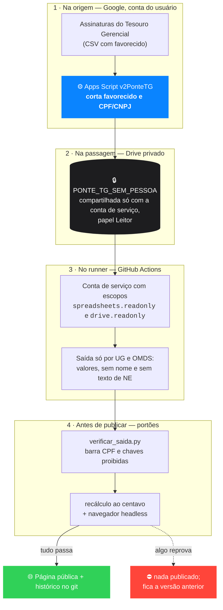
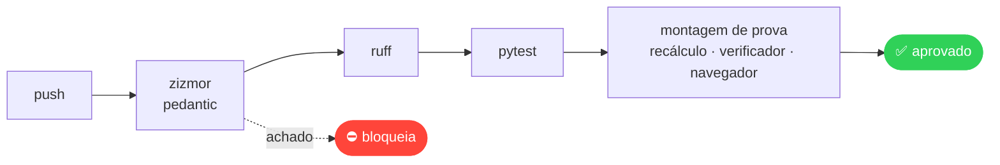
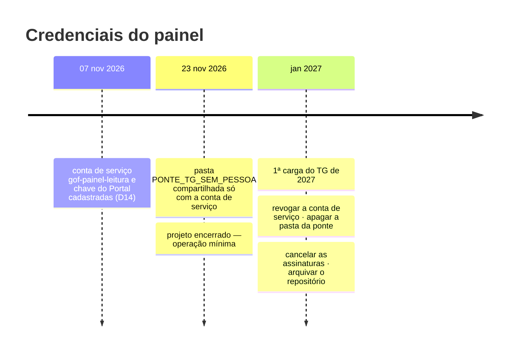

  

  
  
  
  

> Este repositório e a página são **públicos por desenho**. A proteção não depende de esconder o código: depende de **o dado pessoal nunca chegar aqui** e de **nada ser publicado sem passar pelos portões**.

---

## 🛡️ Defesa em camadas

**Onde o dado pessoal morre:** no Apps Script, dentro da conta Google do usuário, **antes** de qualquer arquivo ir ao Drive compartilhado. As colunas de favorecido (nome e CPF/CNPJ) nunca chegam ao GitHub, nem em artefato, nem em log.

---

## 🔑 Segredos

| Segredo (GitHub) | O que é | Alcance | Usado em |
|---|---|---|---|
| `GOOGLE_SA_JSON` | chave da conta de serviço `gof-painel-leitura` | **Leitor** da planilha GCALC e da pasta `PONTE_TG_SEM_PESSOA`; escopos só de leitura | `montagem.yml`, `conferencia.yml` |
| `PORTAL_TRANSPARENCIA_API_KEY` | chave da API do Portal da Transparência | consulta pública (reserva do B1) | `montagem.yml` |

**Nunca aqui:** token pessoal do GitHub, chave do Composio, conta de serviço com escrita. O teto (decisão D14) é de **dois** segredos, ambos de leitura. Os dois foram cadastrados em 07/11/2026.

---

## ⚙️ Workflows endurecidos

| Regra | Estado conferido |
|---|---|
| Actions fixadas por SHA de 40 caracteres | **16 de 16** |
| `permissions: contents: read` no topo | **6 de 6** workflows |
| Escrita só no job que grava | `contents: write` nos jobs que gravam histórico (montagem, fichas, conferência, capacidade); `pages: write` só na publicação; `issues: write` só no vigia |
| `persist-credentials: false` no checkout | **6 de 6** |
| Entradas externas só por `env` (sem `${{ }}` em `run`) | auditado pelo zizmor |
| `zizmor` a cada push (persona pedantic) | portão 7 do CI; workflow novo não entra sem ele |

---

## 🚫 Dado pessoal: o que barra o quê

| Trava | Onde | O que impede |
|---|---|---|
| Corte de colunas | `PonteTG.gs` (Apps Script do GOF) | favorecido e CPF/CNPJ saírem do Gmail |
| Saída agregada | `gof_regua_tg.py`, `gof_ponte_tg.py` | texto de NC/NE ir à página (só UG, OMDS e valores) |
| Verificador | `motor/verificar_saida.py` | padrão de CPF (formatado ou mascarado) e chaves `favorecido`, `codigoFavorecido`, `observacao`, `contato`, `telefone`, `email`, `cpf` |
| Histórico público | decisão D13 | só extratos sem pessoa e dados de gestão admitidos pelo usuário entram no git |

> **O que for publicado fica no histórico do git.** Por isso o corte é na origem e o verificador roda antes de cada publicação, não depois.

---

## 📅 Ciclo de vida das credenciais

---

## 📣 Reportar um problema

1. Abra uma **issue** descrevendo **onde** está o problema (arquivo, linha, URL).
2. **Não** cole o dado sensível na issue, nem em print.
3. Se for vazamento de dado pessoal na página: a correção é tirar da saída **e** avaliar a reescrita do histórico com o responsável (o histórico é público).

Normas de referência: Lei nº 13.709/2018 (LGPD) para o tratamento de dado pessoal; Lei nº 12.527/2011 (LAI) para a publicidade dos dados de gestão.
