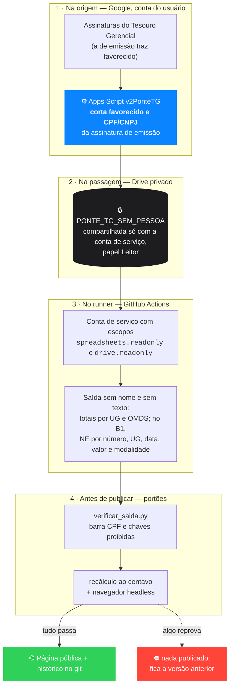
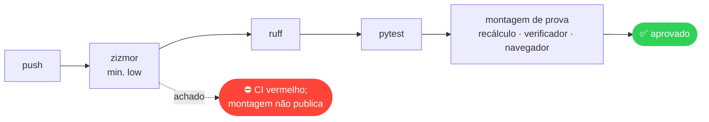
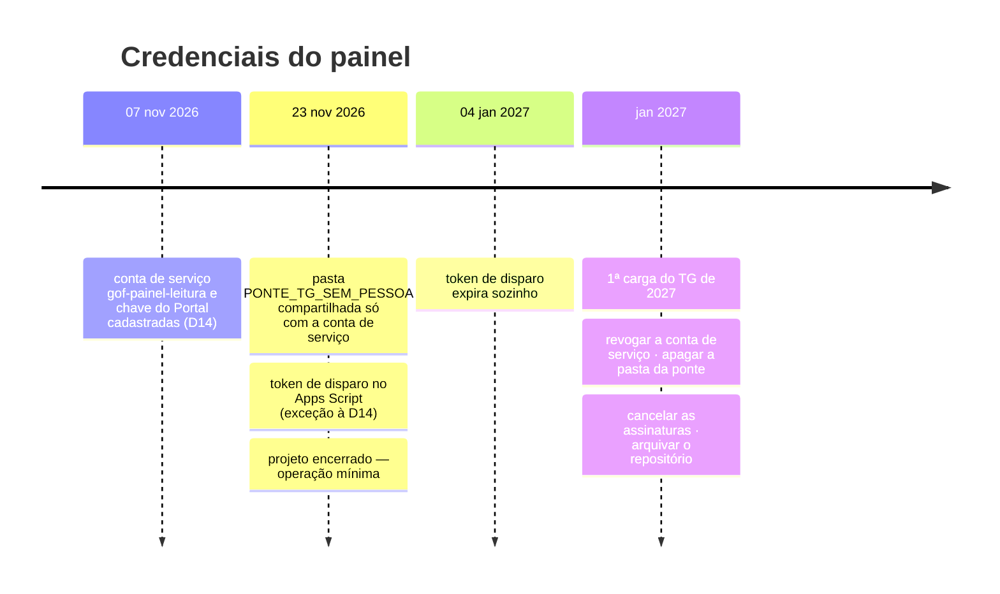

  

  
  
  
  

> Este repositório e a página são **públicos por desenho**. A proteção não depende de esconder o código: depende de **o dado pessoal nunca chegar aqui** e de **nada ser publicado sem passar pelos portões**.

---

## 🛡️ Defesa em camadas

**Onde o favorecido morre:** no Apps Script, dentro da conta Google do usuário, antes de gravar no Drive privado: a assinatura de emissão perde as colunas de favorecido (nome e CPF/CNPJ). As demais (informação complementar e crédito) não têm coluna de favorecido, mas levam **texto livre de NE e de NC**, que pode citar pessoas: esse texto fica só no Drive privado, o motor o usa apenas para o vínculo e para o prazo da NC, e ele nunca entra na saída, em artefato ou em log.

> **Ponto de atenção:** o corte é por posição de coluna. Se o Tesouro Gerencial mudar o layout da assinatura de emissão, o favorecido pode passar ao Drive privado (não ao GitHub, que continua protegido pelo verificador). Revisar `PonteTG.gs` a cada mudança de layout.

---

## 🔑 Segredos

| Segredo (GitHub) | O que é | Alcance | Usado em |
|---|---|---|---|
| `GOOGLE_SA_JSON` | chave da conta de serviço `gof-painel-leitura` | **Leitor** da planilha GCALC e da pasta `PONTE_TG_SEM_PESSOA`; escopos só de leitura | `montagem.yml`, `conferencia.yml` |
| `PORTAL_TRANSPARENCIA_API_KEY` | chave da API do Portal da Transparência | consulta pública (reserva do B1) | `montagem.yml` |

**Nunca aqui:** token pessoal do GitHub, chave do Composio, conta de serviço com escrita. O teto (decisão D14) é de **dois** segredos no repositório, ambos de leitura. Os dois foram cadastrados em 07/11/2026.

### ⚠️ Exceção à D14 — token de disparo (23/11/2026, decisão do usuário)

| | |
|---|---|
| **O quê** | token *fine-grained* do GitHub «Painel 21EM - ponte Apps Script», ampliado para este repositório |
| **Onde fica** | **fora do GitHub**: na propriedade `GITHUB_DISPATCH_TOKEN` do Apps Script do GOF (conta Google do usuário); nunca no código nem no git |
| **Alcance** | só `painel-gof-baaplog` e `painel-21em-catrimani`; permissões *Contents: read and write* e *Metadata: read* |
| **Para quê** | `v2PonteTG` aciona a montagem (`repository_dispatch`, tipo `csv-chegou`) assim que grava arquivo novo, em vez de esperar a agenda do GitHub, que atrasa horas |
| **Validade** | **04/01/2027** (expira sozinho); revogar antes se o painel for arquivado |
| **Risco aceito** | quem obtiver o token pode alterar o código deste repositório (e, por ele, a página); mitigado por ficar só na conta Google do usuário, pelo alcance de dois repositórios e pela validade curta |
| **Sem o token** | nada quebra: `v2PonteTG` registra «sem token, fica a agenda» e a montagem sai pela agenda |

---

## ⚙️ Workflows endurecidos

| Regra | Estado conferido |
|---|---|
| Actions fixadas por SHA de 40 caracteres | **16 de 16** |
| `permissions: contents: read` no topo | **6 de 6** workflows |
| Escrita só no job que grava | `contents: write` nos jobs que gravam histórico (montagem, fichas, conferência, capacidade); `pages: write` e `id-token: write` (OIDC do deploy) só na publicação; `issues: write` só no vigia |
| `persist-credentials: false` no checkout | **6 de 6** |
| Entradas externas só por `env` (sem `${{ }}` em `run`) | auditado pelo zizmor |
| `zizmor` a cada push (severidade e confiança mínimas «low») | portão 7: no CI e de novo na montagem; zizmor reprovado **impede a publicação** (o push em si não é bloqueado: a `main` não tem proteção de branch) |

---

## 🚫 Dado pessoal: o que barra o quê

| Trava | Onde | O que impede |
|---|---|---|
| Corte de colunas | `PonteTG.gs` (Apps Script do GOF) | favorecido e CPF/CNPJ saírem do Gmail |
| Saída sem texto | `gof_regua_tg.py`, `gof_ponte_tg.py` | texto de NC/NE ir à página (totais por UG e OMDS; no B1, NE por número, sem favorecido) |
| Verificador | `motor/verificar_saida.py` | padrão de CPF formatado ou mascarado (não pega 11 dígitos soltos nem CNPJ: por isso o corte é na origem) e chaves `favorecido`, `codigoFavorecido`, `observacao`, `contato`, `telefone`, `email`, `cpf` |
| Histórico público | decisões D7 e D13 | só extratos sem pessoa (D7); dados de gestão (fase, prazo, pendências) publicados por decisão do usuário, com risco aceito (D13, 07/11/2026); contatos das SALC e observação livre ficam fora |

> **O que for publicado fica no histórico do git.** Por isso o corte é na origem e o verificador roda antes de cada publicação, não depois.

---

## 📅 Ciclo de vida das credenciais

---

## 📣 Reportar um problema

1. Abra uma **issue** descrevendo **onde** está o problema (arquivo, linha, URL).
2. **Não** cole o dado sensível na issue, nem em print.
3. Se for vazamento de dado pessoal na página: a correção é tirar da saída **e** avaliar a reescrita do histórico com o responsável (o histórico é público).

Normas de referência: Lei nº 13.709/2018 (LGPD) para o tratamento de dado pessoal; Lei nº 12.527/2011 (LAI) para a publicidade dos dados de gestão.
